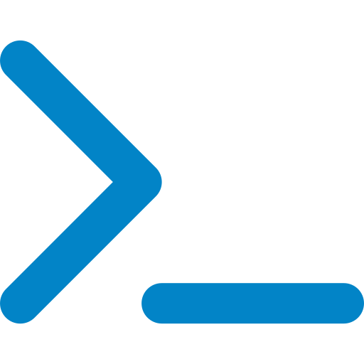

<div align="center">

  

  <a href="https://eslam-yasser-portfolio.vercel.app/">
    
  </a>

  <p><b>Computer Science Student &middot; Full-Stack Engineer &middot; Tech Instructor</b></p>
  <p><i>Crafting high-performance web systems with clean architecture, robust APIs, and modern UI engineering.</i></p>

  <table>
    <tr>
      <td align="center"><a href="https://eslam-yasser-portfolio.vercel.app/"><br/><sub>Portfolio</sub></a></td>
      <td align="center"><a href="https://www.linkedin.com/in/eslam-yasser-a57435353"><br/><sub>LinkedIn</sub></a></td>
      <td align="center"><a href="https://github.com/eslamyf"><br/><sub>GitHub</sub></a></td>
      <td align="center"><a href="https://codeforces.com/profile/eslam_yasser_fawzi"><br/><sub>Codeforces</sub></a></td>
      <td align="center"><a href="mailto:eslam9076460@gmail.com"><br/><sub>Email</sub></a></td>
      <td align="center"><br/><sub>Qena, Egypt</sub></td>
    </tr>
  </table>

  
</div>


##  At a Glance

<table>
  <tr>
    <td align="center" width="25%"><br/><b>CS Student</b><br/><sub>FCI · South Valley University<br/>2024 – 2028</sub></td>
    <td align="center" width="25%"><br/><b>MEAN + React</b><br/><sub>Full-stack apps<br/>from API to UI</sub></td>
    <td align="center" width="25%"><br/><b>95% at NTI</b><br/><sub>MEAN Stack<br/>training</sub></td>
    <td align="center" width="25%"><br/><b>Instructor</b><br/><sub>Weekly hands-on<br/>web sessions</sub></td>
  </tr>
</table>


##  Code Snapshot

```typescript
const eslam = {
  name: "Eslam Yasser",
  location: "Qena, Egypt",
  focus: ["Full-Stack Web Development", "RESTful API Architecture"],
  roles: [
    "Full-Stack Developer (MEAN & React)",
    "Web Development Instructor @ Support Web Program",
    "Coordinator @ Students for Egypt",
    "Vice, Operations @ NTI Ambassadors Qena",
  ],
  stack: ["Angular", "React", "TypeScript", "Node.js", "Express.js", "MongoDB", "C++"],
  mindset: ["Clean Code", "Simplifying CS Concepts", "Scalable Systems"],
  openToWork: true, // Cairo · on-site / hybrid / remote
};
```


##  Skills &amp; Technologies

<table>
  <tr>
    <td align="center"><br/><b>Frontend</b></td>
    <td><code>Angular</code> <code>React</code> <code>TypeScript</code> <code>JavaScript</code> <code>HTML5</code> <code>CSS3</code> <code>Bootstrap</code></td>
  </tr>
  <tr>
    <td align="center"><br/><b>Backend</b></td>
    <td><code>Node.js</code> <code>Express.js</code> <code>RESTful APIs</code> <code>JWT Auth</code> <code>MVC Pattern</code></td>
  </tr>
  <tr>
    <td align="center"><br/><b>Databases</b></td>
    <td><code>MongoDB</code> <code>SQL Basics</code> <code>ERD &amp; Database Design</code></td>
  </tr>
  <tr>
    <td align="center"><br/><b>Tools &amp; CS</b></td>
    <td><code>C++ (OOP)</code> <code>Python</code> <code>Data Structures</code> <code>Algorithms</code> <code>Git</code> <code>GitHub</code> <code>Postman</code></td>
  </tr>
</table>


##  Featured Projects

<table>
  <tr>
    <td width="50%" valign="top">
      <h3> <a href="https://github.com/eslamyf/aqario-luxe-web">Aqario Luxe</a></h3>
      <p><b>Real Estate Management System</b></p>
      <p>Full-stack real estate platform built with the MEAN stack: structured MongoDB schemas, clean MVC pattern, and a freemium model with secure payment integration.</p>
      <p><code>Angular</code> &middot; <code>Node.js</code> &middot; <code>Express.js</code> &middot; <code>MongoDB</code> &middot; <code>JWT</code></p>
      <p><a href="https://github.com/eslamyf/aqario-luxe-web">Repository</a> &middot; <a href="https://aqario-luxe.vercel.app">Live Demo</a></p>
    </td>
    <td width="50%" valign="top">
      <h3> <a href="https://github.com/eslamyf/educational-platform">Educational Platform</a></h3>
      <p><b>Course Management &amp; Progress Tracker</b></p>
      <p>Lets students browse learning materials and track course progression. Built with a modular MEAN architecture and robust RESTful API endpoints.</p>
      <p><code>MEAN Stack</code> &middot; <code>Node.js</code> &middot; <code>MongoDB</code> &middot; <code>REST APIs</code> &middot; <code>MVC</code></p>
      <p><a href="https://github.com/eslamyf/educational-platform">Repository</a></p>
    </td>
  </tr>
  <tr>
    <td width="50%" valign="top">
      <h3> <a href="https://github.com/eslamyf">Foodio</a></h3>
      <p><b>Campus Food Delivery Web App</b></p>
      <p>Connects local restaurants with university students, with cart management, a favorites list, and a modular structure for high maintainability.</p>
      <p><code>Angular</code> &middot; <code>Node.js</code> &middot; <code>REST APIs</code> &middot; <code>TypeScript</code></p>
      <p><a href="https://github.com/eslamyf">GitHub Profile</a></p>
    </td>
    <td width="50%" valign="top">
      <h3> <a href="https://github.com/eslamyf/eslam-yasser-portfolio">Personal Portfolio</a></h3>
      <p><b>Interactive Developer Portfolio</b></p>
      <p>Modern React portfolio showcasing production projects, technical skills, verified certificates, CV, and a fully responsive design.</p>
      <p><code>React</code> &middot; <code>Vite</code> &middot; <code>Modern CSS</code> &middot; <code>Lucide</code></p>
      <p><a href="https://github.com/eslamyf/eslam-yasser-portfolio">Repository</a> &middot; <a href="https://eslam-yasser-portfolio.vercel.app/">Live Demo</a></p>
    </td>
  </tr>
</table>


##  Experience &amp; Training

<table>
  <tr>
    <td> <b>Web Development Instructor</b><br/><i>Support Web Program &middot; Qena, Egypt</i></td>
    <td align="right"><code>June 2026 — Present</code></td>
  </tr>
  <tr><td colspan="2">Deliver weekly practical sessions in HTML, CSS, and JavaScript for Computer Science students, turning core programming concepts into hands-on exercises and tracking student growth.</td></tr>
  <tr>
    <td> <b>NextGen Creatives &mdash; MarTech Track</b><br/><i>Creativa Qena, Egypt</i></td>
    <td align="right"><code>2026 — Present</code></td>
  </tr>
  <tr><td colspan="2">Collaborative training focused on creative problem-solving, user-centered design, and delivering practical technological solutions in agile team setups.</td></tr>
  <tr>
    <td> <b>MEAN Stack Web Developer Trainee</b><br/><i>NTI - Creativa Innovation Hubs (DEY Initiative)</i></td>
    <td align="right"><code>Jan 2026 — May 2026</code></td>
  </tr>
  <tr><td colspan="2">Completed intensive accelerator building end-to-end full-stack applications with MongoDB, Express.js, Angular, Node.js, JWT authentication, and asynchronous data streams.</td></tr>
  <tr>
    <td> <b>React Developer Trainee</b><br/><i>Information Technology Institute (ITI), Egypt</i></td>
    <td align="right"><code>2026</code></td>
  </tr>
  <tr><td colspan="2">Mastered modern component-based UI engineering, hooks, state architecture, and client-side application data flow.</td></tr>
  <tr>
    <td> <b>Coordinator</b> · <i>Students for Egypt (FCI)</i><br/><b>Vice, Operations</b> · <i>NTI Ambassadors Qena</i></td>
    <td align="right"><code>Community leadership</code></td>
  </tr>
  <tr><td colspan="2">Started as a PR member and grew to Head of PR, then Coordinator. Leading operations and organizing events and teams on campus.</td></tr>
</table>


##  Certifications &amp; Honors

| | Certification | Issuer | Date |
|:-:|---|---|---|
|  | **ICPC Egyptian Collegiate Programming Contest (ECPC) 2026 – Qualifications** | ICPC | Aug 2026 |
|  | **NASA International Space Apps Challenge** | NASA | Oct 2026 |
|  | **Cybersecurity Academy (Undergraduate Level)** | NTI &amp; EG-CERT | Jun 2025 |
|  | **InnovEgypt – Innovation &amp; Entrepreneurship Track** | TIEC | Aug 2026 |
|  | **Startup Innovation Lab** | Creativa TIEC Qena | Jun 2026 |
|  | **Python Programming Fundamentals** | Creativa TIEC Qena | Jul 2026 |
|  | **Learn C++ from Scratch** | Udemy | Sep 2025 |


##  GitHub Analytics

<div align="center">
  <picture>
    <source media="(prefers-color-scheme: dark)" srcset="https://github-readme-stats.vercel.app/api?username=eslamyf&amp;show_icons=true&amp;theme=tokyonight&amp;hide_border=true&amp;bg_color=0d1117" />
    
  </picture>
  <picture>
    <source media="(prefers-color-scheme: dark)" srcset="https://github-readme-stats.vercel.app/api/top-langs/?username=eslamyf&amp;layout=compact&amp;theme=tokyonight&amp;hide_border=true&amp;bg_color=0d1117" />
    
  </picture>
  <br/><br/>
  <picture>
    <source media="(prefers-color-scheme: dark)" srcset="https://streak-stats.demolab.com?user=eslamyf&amp;theme=tokyonight&amp;hide_border=true&amp;background=0d1117" />
    
  </picture>
  <br/><br/>
  <picture>
    <source media="(prefers-color-scheme: dark)" srcset="https://github-profile-trophy.vercel.app/?username=eslamyf&amp;theme=onedark&amp;no-frame=true&amp;no-bg=true&amp;row=1&amp;column=7" />
    
  </picture>
  <br/><br/>
  <picture>
    <source media="(prefers-color-scheme: dark)" srcset="https://github-readme-activity-graph.vercel.app/graph?username=eslamyf&amp;theme=tokyo-night&amp;hide_border=true&amp;area=true&amp;bg_color=0d1117" />
    
  </picture>
  <br/><br/>
  <picture>
    <source media="(prefers-color-scheme: dark)" srcset="https://raw.githubusercontent.com/eslamyf/eslamyf/output/github-snake-dark.svg" />
    <source media="(prefers-color-scheme: light)" srcset="https://raw.githubusercontent.com/eslamyf/eslamyf/output/github-snake.svg" />
    
  </picture>
</div>


##  Get In Touch

<div align="center">
  <p><b>Interested in collaborating or discussing an opportunity? Feel free to reach out!</b></p>
  <p>
    <a href="mailto:eslam9076460@gmail.com">Email: eslam9076460@gmail.com</a> &middot;
    <a href="https://www.linkedin.com/in/eslam-yasser-a57435353">LinkedIn: Eslam Yasser</a> &middot;
    <a href="https://eslam-yasser-portfolio.vercel.app/">Portfolio</a>
  </p>
  <sub>Built with  and a lot of coffee · Qena, Egypt</sub>
</div>
