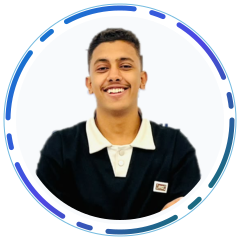
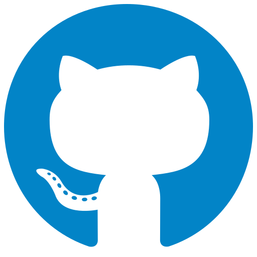
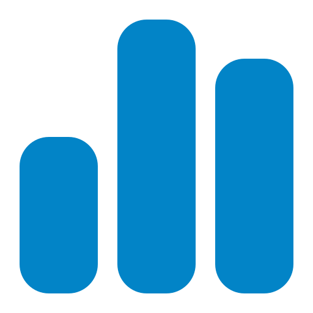
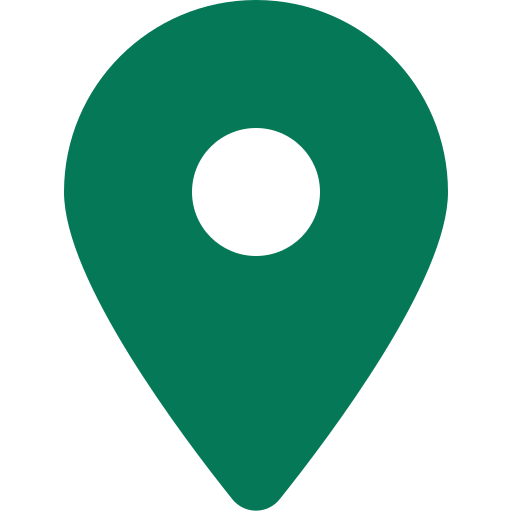
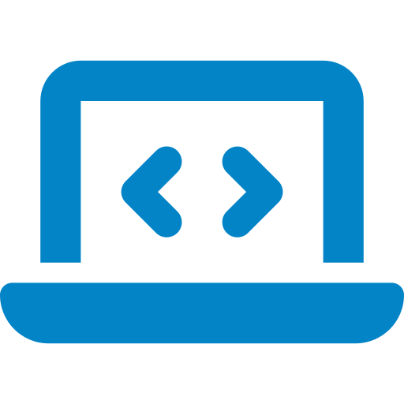
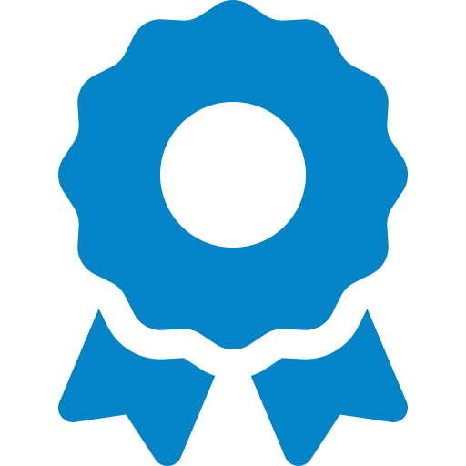
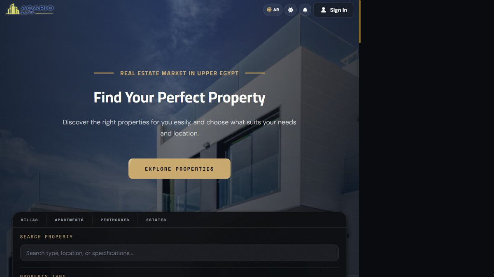
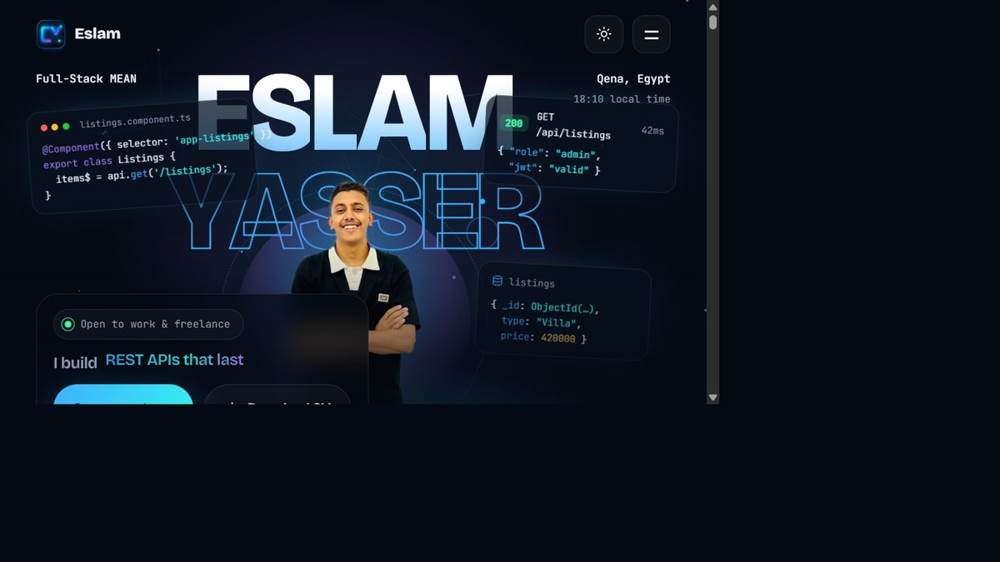

  

  

    

  

    

  <!-- Interactive Typing Animation -->
  

  
<b>Computer Science Student &bull; Full-Stack Developer &bull; Web Development Instructor</b>

  
<i>Crafting scalable web systems with clean architecture, robust APIs, and modern UI engineering.</i>

  

    &nbsp;&nbsp;
    &nbsp;&nbsp;
    &nbsp;&nbsp;
    &nbsp;&nbsp;
    &nbsp;&nbsp;
    
  

  

 

## ⚡ Highlights

<table>
  <tr>
    <td align="center" width="25%">
       
      <b>CS Student</b> 
      Faculty of Computers &amp; Info South Valley University (2024–2028)
    </td>
    <td align="center" width="25%">
       
      <b>MEAN &amp; React</b> 
      Full-stack web engineering from REST APIs to modern UI
    </td>
    <td align="center" width="25%">
       
      <b>95% at NTI</b> 
      MEAN Stack Development Track Creativa DEY Initiative
    </td>
    <td align="center" width="25%">
       
      <b>Web Instructor</b> 
      Hands-on mentoring at Support Web Program
    </td>
  </tr>
</table>

 

## 🛠️ Skills &amp; Tech Stack

  

 

<table>
  <tr>
    <td width="20%"><b>Frontend</b></td>
    <td>
      
      
      
      
      
      
      
    </td>
  </tr>
  <tr>
    <td><b>Backend &amp; APIs</b></td>
    <td>
      
      
      
      
      
    </td>
  </tr>
  <tr>
    <td><b>Databases</b></td>
    <td>
      
      
      
    </td>
  </tr>
  <tr>
    <td><b>Core &amp; Tools</b></td>
    <td>
      
      
      
      
      
      
    </td>
  </tr>
</table>

 

## 🚀 Featured Projects

High-impact, production-ready web applications with live deployments:

<table>
  <tr>
    <td width="50%" valign="top">
      

        
      

       
      

        <h3>🏡 <a href="https://aqario-luxe.vercel.app/">Aqario Luxe</a></h3>
        
A full-stack property marketplace engineered with the MEAN stack, featuring intelligent catalog filtering, dynamic property listings, secure user authentication, and responsive UI architecture.

        
<b>✨ Key Highlights:</b>

        <ul>
          <li>Structured MongoDB data models &amp; indexing</li>
          <li>RESTful API with JWT authentication &amp; role guards</li>
          <li>Component-driven Angular client with reactive forms</li>
        </ul>
        

          
          
          
          
          
        

        

          &nbsp;
          
        

      

    </td>
    <td width="50%" valign="top">
      

        
      

       
      

        <h3>⚡ <a href="https://eslam-yasser-portfolio.vercel.app/">Personal Portfolio</a></h3>
        
A modern, high-performance developer portfolio built with React and Vite, showcasing engineering projects, interactive UI elements, and a clean dark aesthetic.

        
<b>✨ Key Highlights:</b>

        <ul>
          <li>Ultra-fast Vite build tooling &amp; HMR</li>
          <li>Modular component architecture with custom React hooks</li>
          <li>Fluid responsive layouts &amp; accessible navigation</li>
        </ul>
        

          
          
          
          
        

        

          &nbsp;
          
        

      

    </td>
  </tr>
</table>

 

## 💼 Experience &amp; Leadership

<table>
  <tr>
    <td>
      <b>Web Development Instructor</b> 
      <i>Support Web Program &bull; Qena, Egypt</i>
    </td>
    <td align="right"><code>June 2026 — Present</code></td>
  </tr>
  <tr>
    <td colspan="2">
      Deliver weekly practical sessions in HTML, CSS, JavaScript, and core programming concepts for Computer Science students, turning theory into real-world hands-on projects and tracking student growth.
    </td>
  </tr>
  <tr>
    <td>
      <b>MEAN Stack Web Developer Trainee</b> 
      <i>National Telecommunication Institute (NTI) &bull; Creativa Innovation Hubs (DEY Initiative)</i>
    </td>
    <td align="right"><code>Jan 2026 — May 2026</code></td>
  </tr>
  <tr>
    <td colspan="2">
      Intensive accelerator program building full-stack web applications with MongoDB, Express.js, Angular, Node.js, and JWT authentication. Completed with <b>95% excellence score</b>.
    </td>
  </tr>
  <tr>
    <td>
      <b>React Developer Trainee</b> 
      <i>Information Technology Institute (ITI), Egypt</i>
    </td>
    <td align="right"><code>2026</code></td>
  </tr>
  <tr>
    <td colspan="2">
      Hands-on training in modern component-based UI engineering, custom React hooks, state management, and responsive frontend architectures.
    </td>
  </tr>
  <tr>
    <td>
      <b>Coordinator</b> &bull; <i>Students for Egypt (FCI)</i> 
      <b>Vice, Operations</b> &bull; <i>NTI Ambassadors Qena</i>
    </td>
    <td align="right"><code>Campus Leadership</code></td>
  </tr>
  <tr>
    <td colspan="2">
      Led student activities, public relations, campus tech initiatives, and organized workshops and university events.
    </td>
  </tr>
</table>

 

## 🏆 Certifications &amp; Honors

| | Certification / Honor | Issuer | Date |
|:---:|---|---|:---:|
| 🏆 | **ICPC Egyptian Collegiate Programming Contest (ECPC) 2026 – Qualifications** | ICPC | Aug 2026 |
| 🛰️ | **NASA International Space Apps Challenge** | NASA | Oct 2026 |
| 🛡️ | **Cybersecurity Academy (Undergraduate Level)** | NTI &amp; EG-CERT | Jun 2025 |
| 💡 | **InnovEgypt – Innovation &amp; Entrepreneurship Track** | TIEC | Aug 2026 |
| 🧪 | **Startup Innovation Lab** | Creativa TIEC Qena | Jun 2026 |
| 🐍 | **Python Programming Fundamentals** | Creativa TIEC Qena | Jul 2026 |
| ⚙️ | **Learn C++ from Scratch** | Udemy | Sep 2025 |

 

## 📈 GitHub Activity

  
    
  <picture>
    <source media="(prefers-color-scheme: dark)" srcset="https://raw.githubusercontent.com/eslamyf/eslamyf/output/github-snake-dark.svg" />
    <source media="(prefers-color-scheme: light)" srcset="https://raw.githubusercontent.com/eslamyf/eslamyf/output/github-snake.svg" />
    
  </picture>

 

## 📬 Get In Touch

  
<b>Interested in collaborating, hiring, or discussing a web project? Let's connect!</b>

  

    &nbsp;
    &nbsp;
    
  

  Designed &amp; Built with care &bull; Qena, Egypt
    
  

